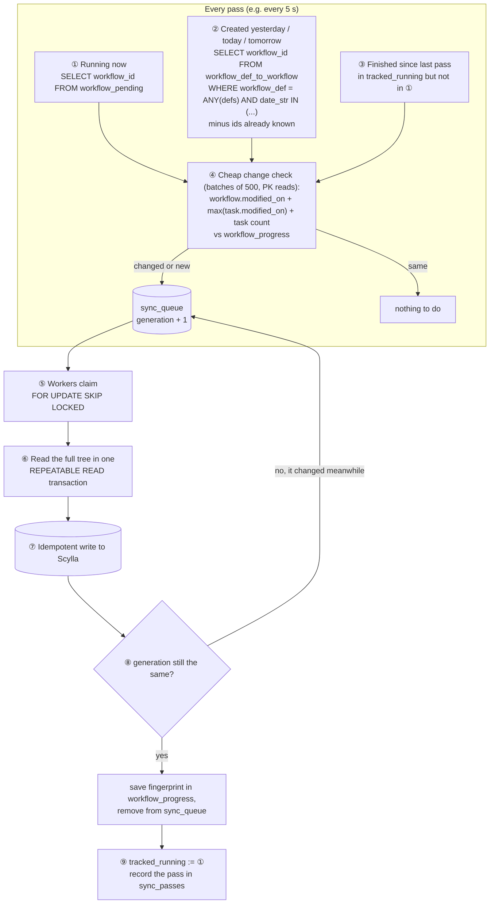

# data-migrator: Postgres → Scylla (plan)

A small Go service that copies **all** Conductor persistence data from a
Conductor Postgres database into the tenant-aware Scylla schema, **directly at
the database level** (no Conductor REST APIs). It is resumable, keeps running
workflows in sync until cutover, and records its progress in a small Postgres
"state" database.

Redis (queues, timers, locks) and OpenSearch (search index) are **shared**
between the two deployments and are **not** migrated.

---

## 1. Source → target mapping

Postgres stores Conductor's own JSON. The Scylla DAO stores the **same JSON**
in its `payload` columns. So payloads are copied unchanged; the migrator only
builds the Scylla keys, lookups and bookkeeping rows.

| Postgres (source) | Scylla (target) | How |
|---|---|---|
| `workflow` (`workflow_id`, `correlation_id`, `json_data` without tasks, `modified_on`) | `workflows` row `(workflow_id, shard_id, entity='workflow', task_id='')` | `payload` = `json_data`; `version` = 1; statics: `total_tasks` = task count, `total_partitions` = 1, `tenant_id`, `account_id` |
| `task` (`task_id`, `json_data`, `modified_on`) + `workflow_to_task` | `workflows` rows `(workflow_id, shard_id, entity='task', task_id)` | `payload` = task `json_data`, in the workflow's partition |
| (derived) | `workflow_lookup` (`workflow_id` → `shard_id`, `tenant_id`, `account_id`) | one per workflow |
| (derived) | `task_lookup` (`task_id` → `workflow_id`, `shard_id`) | one per task |
| (derived from task status) | `task_in_progress_v2` (`task_def_name`, `task_id` → `workflow_id`, `in_progress_status`) | only non-terminal tasks; status = `IN_PROGRESS`? |
| `meta_task_def` | `task_definitions` (`'task_defs'`, name → JSON) | as is |
| `meta_workflow_def` (name, version, JSON) | `workflow_definitions` (name, version → JSON) + `workflow_defs_index` (`'workflow_def_version_index'`, `"name/version"` → `"name/version"`) | both rows per version |
| `meta_event_handler` | `event_handlers` (`'handlers'`, name → JSON) | as is |
| `event_execution` | `event_executions` (`message_id`, `event_handler_name`, `event_execution_id` → JSON) | as is |
| `poll_data` (`queue_name`, `domain` → `json_data`) | `poll_data` (`queue_name`, `domain` → `json_data`) — **new table**, see [section 4](#4-poll-data) | as is; `domain` = `"DEFAULT"` when empty (same as Postgres) |
| `workflow_pending`, `workflow_def_to_workflow` | — | **not copied**, but **read** by the sync loop to find running and new workflows (section 3.4) |
| `task_scheduled`, `*_index`, `queue*` | — | **not copied**: no Scylla equivalent / search lives in OpenSearch / queues are in Redis |
| `task_def_limit` | `task_def_limit` | only if `concurrencyLimitEnabled=true` (off today) — behind a flag |

---

## 2. Owner (tenant, account) and shard

Must give **exactly** the same result as the Java `ShardResolver`, or the
Scylla Conductor will look in the wrong partition.

### 2.1 Owner, in this order

1. **`input._tenantContext`** in the workflow JSON: `tenantID`, `accountID`.
2. **Sub-workflow** (`parentWorkflowId` set) without `_tenantContext`: the
   **parent's** owner (from the state DB, or resolved from the parent row).
3. **correlationId prefix** (the auth proxy's format):
    - `"<tenant>: <account>: <correlation>"` → tenant + account
    - `"<tenant>: <correlation>"` → tenant only
    - accepted only if `<tenant>` is a **known tenant** (see 2.3), so a
      plain `"ORDER: 1"` is never read as tenant `ORDER`.
4. **Otherwise** (no correlationId, or no known-tenant prefix): tenant
   **`default`**, no account.

Account normalisation (same as Java): blank, `-1`, or equal to the tenant →
no account.

### 2.2 Shard (same rules as `ShardResolver`)

| Case | shard_id | account_id stored |
|---|---|---|
| account is a positive int (`678`) | `678` | `678` |
| account is non-numeric (`acme`) | `1 + floorMod(murmur3(account), MaxInt32)` | `acme` |
| no account, correlationId is a positive int (`12345`) | `12345` | `12345` |
| otherwise | `-(1 + floorMod(murmur3(tenant), 1_000_000))` | `-1` |

`murmur3` = MurmurHash3 **x86_32, seed 0, UTF-8**, read as a **signed** int32;
`floorMod` = Java semantics. A Go test must reuse the Java test vectors
(`"hello"` → `0x248bfa47`) plus a cross-check table generated by the Java
resolver for real tenant / account names.

### 2.3 Open points for the correlationId rule

- **Known tenants:** taken from config (`tenants: [fs, journeys, sip, ...]`),
  optionally also from all `ownerApp` values in `meta_workflow_def`.
- **Ambiguity:** `"fs: ORDER-1: X"` (tenant-only, correlation contains `": "`)
  looks like `"fs: <account ORDER-1>: X"`. Rule: the middle part is an account
  only if it matches `account_pattern` (default: digits only). Otherwise the
  whole rest is the correlation and there is no account.
- Every workflow whose owner came from step 3 or 4 is **counted and listed in
  the report**, per tenant, so it can be reviewed.

---

## 3. Reliability

### 3.1 Idempotent writes

- Scylla `INSERT` is an upsert, and owner + shard are deterministic → re-running
  a workflow always produces the same rows.
- `total_tasks` is **set**, never incremented.
- Write order per workflow:
    1. **one single-partition unlogged batch**: workflow row + all task rows +
       statics (atomic within the partition; split if it exceeds the batch size
       limit),
    2. `task_lookup` rows,
    3. `task_in_progress_v2` rows (insert non-terminal, delete terminal),
    4. **`workflow_lookup` last** — the "commit" marker.
       A crash in the middle leaves no lookup; the retry rewrites everything.
- **Removed tasks** (retry / rerun delete task rows on the source): on every
  re-copy, compare task-id sets and delete extra task rows + lookups.

### 3.2 Consistent reads

Read a workflow and its tasks in **one `REPEATABLE READ`, read-only
transaction**, so the copy is a consistent snapshot. Prefer a **read replica**
for the initial bulk copy.

### 3.3 State DB (small Postgres) — resume from where it stopped

The state DB is the migrator's memory: what was copied, what still needs
copying (a work queue), and where each phase stopped.

```sql
-- Last copied state of every workflow (holds the "fingerprint")
CREATE TABLE workflow_progress (
  workflow_id        text PRIMARY KEY,
  status             text NOT NULL,          -- done | failed | deleted
  src_status         text,                   -- RUNNING / COMPLETED / ... at last copy
  wf_modified_on     timestamptz,            -- source workflow.modified_on
  max_task_modified  timestamptz,            -- max source task.modified_on
  task_count         int,
  checksum           text,                   -- hash of workflow + task payloads
  tenant_id text, account_id text, shard_id int,
  owner_source       text,                   -- tenant_context | parent | correlation | default
  attempts int NOT NULL DEFAULT 0,
  last_error text,
  migrated_at timestamptz
);

-- Work queue: workflows that are NOT in sync yet
CREATE TABLE sync_queue (
  workflow_id    text PRIMARY KEY,
  generation     bigint NOT NULL DEFAULT 1,  -- +1 every time it is marked dirty
  reason         text,                       -- running | new | finished | bulk | retry
  first_dirty_at timestamptz NOT NULL DEFAULT now(),
  last_dirty_at  timestamptz NOT NULL DEFAULT now(),
  claimed_by     text,
  claimed_at     timestamptz,
  attempts       int NOT NULL DEFAULT 0,
  last_error     text
);
CREATE INDEX sync_queue_claim ON sync_queue (claimed_at NULLS FIRST, first_dirty_at);

-- Running set seen in the previous pass (to find "finished since last pass")
CREATE TABLE tracked_running (
  workflow_id   text PRIMARY KEY,
  workflow_type text NOT NULL,
  first_seen    timestamptz NOT NULL DEFAULT now(),
  last_seen     timestamptz NOT NULL DEFAULT now()
);

-- One row per sync pass (audit + lag)
CREATE TABLE sync_passes (
  id bigserial PRIMARY KEY,
  started_at timestamptz, ended_at timestamptz,
  running int, discovered_new int, finished int,
  changed int, copied int, failed int, deleted int,
  poll_data_copied int,
  max_lag_ms bigint
);

-- Cursors and positions: bulk_cursor, event_cursor, ...
CREATE TABLE checkpoints (
  name text PRIMARY KEY, value text NOT NULL, updated_at timestamptz NOT NULL DEFAULT now()
);

-- Definitions
CREATE TABLE definition_progress (
  kind text, name text, version int, checksum text, migrated_at timestamptz,
  PRIMARY KEY (kind, name, version)
);

-- Poll data (small table: one row per queue + domain)
CREATE TABLE poll_data_progress (
  queue_name text, domain text,
  last_poll_time bigint,                     -- PollData.lastPollTime copied last
  migrated_at timestamptz,
  PRIMARY KEY (queue_name, domain)
);

-- Each run of each command (audit)
CREATE TABLE runs (
  id bigserial PRIMARY KEY, command text, started_at timestamptz, ended_at timestamptz,
  status text, counts jsonb, error text
);
```

- **Bulk copy** pages through `workflow` ordered by `workflow_id` (keyset, no
  `OFFSET`), and saves `bulk_cursor` after each page is committed. A restart
  continues from the cursor, then retries `failed` rows.

### 3.4 Continuous sync of in-progress workflows (no change to the source DB)

The source DB is **not changed**: no triggers, no new indexes, no replication.
Two small tables that Conductor already maintains tell us where to look:

| Source table | Kept by Conductor | What it gives us |
|---|---|---|
| `workflow_pending` (PK `workflow_type, workflow_id`) | added on every save of a **non-terminal** workflow, removed when it becomes **terminal** | the exact set of **running / paused** workflows (small) |
| `workflow_def_to_workflow` (PK `workflow_def, date_str, workflow_id`) | one row when a workflow is **created**, `date_str = yyyyMMdd` | workflows **created on a day**, per definition — catches short-lived ones that never show up in `workflow_pending` |

Every read in a pass is a **primary-key read**. The cost of a pass grows with
the number of **running** workflows, not with the size of the database.



**Steps:**

1. **Start order:** create the state DB tables → `defs` → start `sync` → start
   `bulk`. Bulk and sync use the same idempotent writer and the same
   fingerprint check, so the order between them does not matter: the newer
   copy always wins.
2. **Discover (each pass):**
    - ① **running now** from `workflow_pending`;
    - ② **created recently** from `workflow_def_to_workflow` for yesterday,
      today and tomorrow (`date_str` uses the Conductor pods' time zone; three
      days covers it), minus ids already in `workflow_progress`;
    - ③ **finished since the last pass**: in `tracked_running`, no longer in ①
      — their final state is copied once.
3. **Change check (④):** for each candidate, read a **fingerprint** by primary
   key — `workflow.modified_on`, `max(task.modified_on)` (through
   `workflow_to_task`, indexed by `workflow_id`) and the task count — and
   compare it with `workflow_progress`. Only changed or new workflows are put
   in `sync_queue`:
   ```sql
   INSERT INTO sync_queue (workflow_id, reason) VALUES ($1, $2)
   ON CONFLICT (workflow_id) DO UPDATE
     SET generation = sync_queue.generation + 1, last_dirty_at = now(), reason = excluded.reason;
   ```
4. **Copy (⑤–⑧):** workers claim ids safely (many workers, no double work;
   a claim older than 5 minutes is taken again):
   ```sql
   UPDATE sync_queue SET claimed_by = $worker, claimed_at = now()
   WHERE workflow_id IN (
     SELECT workflow_id FROM sync_queue
     WHERE claimed_at IS NULL OR claimed_at < now() - interval '5 minutes'
     ORDER BY first_dirty_at LIMIT $n FOR UPDATE SKIP LOCKED)
   RETURNING workflow_id, generation;
   ```
   read the **current** tree in one consistent transaction, write it to Scylla
   (idempotent, including removed tasks), then finish only if nothing changed
   during the copy:
   ```sql
   DELETE FROM sync_queue WHERE workflow_id = $1 AND generation = $claimed_generation;
   -- 0 rows deleted → it changed meanwhile → release the claim, it is copied again
   ```
   If the source row is gone at copy time, delete the workflow in Scylla and
   mark it `deleted`.
5. **Bookkeeping (⑨):** `tracked_running` := running set of this pass; one row
   in `sync_passes` (counts + lag).
6. **Poll data:** copied in the same pass (see [section 4](#4-poll-data)).
7. **Reconcile** (every N passes, and in the final pass): check known
   workflow ids against the source by primary key, in batches; ids gone from
   the source (archival / remove) are deleted in Scylla and marked `deleted`.

**How we know running workflows are in sync:**

- **Lag** = `now − min(first_dirty_at)` from `sync_queue` (0 = nothing waiting).
- **In-sync check:** for every id in `workflow_pending`, the current source
  fingerprint equals `workflow_progress`, and `sync_queue` is empty.

**Edge cases:**

| Case | Covered by |
|---|---|
| A finished workflow is restarted / retried / rerun | it goes back into `workflow_pending` → next pass |
| A finished workflow changes **without** running again (rare) | optional: re-check fingerprints of workflows created in the last N days via `workflow_def_to_workflow` |
| A workflow is deleted (archival, remove) | reconcile (step 7) |
| A task is removed (retry / rerun) | task-id-set compare on every copy (3.1) |
| The migrator crashes at any point | queue is durable; claims expire after 5 min; writes are idempotent |

### 3.5 Failures

- Retry with exponential backoff on timeouts / unavailable.
- After N attempts: mark `failed`, continue (one bad row never stops the run).
- Bounded worker pool + rate limit (Scylla DBaaS, `LOCAL_QUORUM`).
- Metrics: copied / failed / skipped per tenant, sync lag
  (now − oldest `first_dirty_at`), pass duration; `/healthz` for k8s.

---

## 4. Poll data

Poll data records, per task queue and domain, **which worker polled last and
when**. The UI and `GET /api/tasks/queue/polldata` show it, and the auth proxy
filters it per tenant (by task domain).

Today the Scylla `PollDataDAO` is a **stub** (writes ignored, reads return
`null`). So this needs work in **two places**.

### 4.1 Conductor side (`scylla-persistence`, Java)

New table:

```sql
CREATE TABLE IF NOT EXISTS <keyspace>.poll_data (
  queue_name text,
  domain     text,          -- "DEFAULT" when the poll had no domain (same as Postgres)
  json_data  text,          -- PollData JSON: queueName, domain, workerId, lastPollTime
  PRIMARY KEY ((queue_name), domain)
);
```

Real `ScyllaPollDataDAO`:

| Method | CQL |
|---|---|
| `updateLastPollData(taskDefName, domain, workerId)` | `INSERT INTO poll_data (queue_name, domain, json_data) VALUES (?, ?, ?)` |
| `getPollData(taskDefName, domain)` | `SELECT json_data FROM poll_data WHERE queue_name = ? AND domain = ?` |
| `getPollData(taskDefName)` | `SELECT json_data FROM poll_data WHERE queue_name = ?` (all domains of one queue = one partition) |
| `getAllPollData()` | `SELECT json_data FROM poll_data` (small table: queues × domains) |

- **Write throttling:** `updateLastPollData` is called on **every poll**. Like
  the Postgres DAO, keep the latest value in memory and **flush every N
  seconds** (only rows whose `lastPollTime` moved), so Scylla gets at most one
  write per queue + domain per interval.
- **Tenant scoping:** no tenant column. The task **domain** already carries the
  tenant (the auth proxy prefixes poll domains with the tenant and filters the
  poll-data response per tenant), same as Postgres today.
- Table created at startup like the other tables (`CREATE TABLE IF NOT EXISTS`).

This Java change must be **deployed in the Scylla Conductor before cutover**.

### 4.2 Migrator side

- The source `poll_data` table is small, so each sync pass **reads all of it**
  (`SELECT queue_name, domain, json_data FROM poll_data`) and upserts the rows
  whose `lastPollTime` is newer than `poll_data_progress.last_poll_time`.
- `domain` is copied as is (`"DEFAULT"` stays `"DEFAULT"`).
- Final copy in the cutover pass, after the Postgres Conductor is stopped.
- Poll data is informational (it does not drive execution), so a few seconds
  of difference at cutover are harmless.

---

## 5. Commands (one binary)

```
data-migrator init        # create / upgrade the state DB tables
data-migrator defs        # task defs, workflow defs (+ index), event handlers
data-migrator bulk        # initial copy of all workflows (resumable)
data-migrator events      # event executions (resumable)
data-migrator polldata    # copy poll data once (also done in every sync pass)
data-migrator sync        # continuous sync loop (3.4) + poll data + periodic reconcile; --once for one pass
data-migrator reconcile   # find source deletes, apply them
data-migrator verify      # counts per status/tenant, owner checks, in-sync check, N random trees field-by-field
data-migrator status      # progress and lag from the state DB
data-migrator retry       # retry failed rows, or --workflow <id>
```

Layout (same as `services/opensearch-proxy`):

```
services/data-migrator/
  cmd/data-migrator/main.go
  internal/config      # YAML + env
  internal/source      # Postgres reader (pgx)
  internal/target      # Scylla writer (scylladb/gocql), prepared statements
  internal/owner       # tenant/account/shard rules + murmur3 (+ Java cross-check tests)
  internal/state       # state DB + its schema migrations
  internal/migrate     # defs, bulk, events, polldata, sync, reconcile
  internal/verify
  config.yaml
  Dockerfile
  docs/PLAN.md
```

Runs as a k8s Deployment (sync loop) or Job (bulk / verify); secrets from k8s.

---

## 6. Cutover with no lost work

**Hard rule:** two Conductor engines must never process the **same** Redis
queues at the same time (both would run the same tasks). So there is always
one moment where the Postgres engine stops and the Scylla engine starts.

Goal: callers see **no errors** and **no lost work**; workflow execution pauses
only for the switch (target: under 1–2 minutes).

1. **Before:** `init` → `defs` → `sync` running → `bulk` → `events`; sync lag a
   few seconds, `verify` clean. The Scylla Conductor runs the image with the
   real poll-data DAO (section 4.1), is configured with the **Postgres
   deployment's** Redis prefixes, lock namespace and index name, and is kept at
   **0 replicas**.
2. **Hold writes at the proxy:** the auth proxy answers write calls for the
   tenant with a retryable `503` + `Retry-After` (callers/workers retry), or
   Envoy retries upstream for the window.
3. **Stop the Postgres Conductor:** scale core + async to 0; wait until pods are
   gone and no Conductor sessions are active in Postgres.
4. **Final pass:** `sync --once` (workflows + poll data) + `reconcile` +
   `verify` (seconds, the delta is tiny). **Gate:** `sync_queue` empty, every
   `workflow_pending` id has a matching fingerprint, `verify` clean.
5. **Start the Scylla Conductor** (same Redis prefixes → it picks up all queued
   work and timers), wait for ready.
6. **Switch proxy routing** to the Scylla service and lift the write hold.
7. **Rollback:** Postgres was only read. Scale Scylla to 0, Postgres up, switch
   routing back (anything written to Scylla after step 6 would be lost, so
   decide quickly).

Optional: do this **per tenant** through the proxy's tenant → cluster
routing, to keep each switch small.

---

## 7. Things to keep in mind

- **Ids stay the same** (workflow, task, event execution) — Redis refers to them.
- The Scylla Conductor caches definitions for 60 s → run `defs` first.
- External payloads (S3) are references in the JSON; both deployments use the
  same bucket.
- Event executions in Scylla: inserted like the DAO (no TTL on insert).
- Large source: bulk copy from a **read replica**; sync loop + final pass from the
  primary.
- Strict mode in the Scylla Conductor is compatible: every migrated workflow
  has an owner (`default` at worst).

---

## 8. Decisions still open

1. **Known tenants list** for the correlationId rule — from config only, or
   also from `ownerApp` values?
2. **Account format** in correlationId — digits only (default), or a pattern?
3. **Write hold during cutover** — retryable 503 at the proxy, or Envoy
   upstream retries? Is a 1–2 minute execution pause acceptable?
4. **State DB** — a new small database on the existing Postgres host, or a
   separate instance?
