# Tenant isolation in Scylla persistence

This document explains how Conductor keeps each customer's workflows separate
when many customers share **one** Scylla database.

It covers:

1. [The idea in one minute](#1-the-idea-in-one-minute)
2. [Words used in this document](#2-words-used-in-this-document)
3. [How the caller's identity reaches the database code](#3-how-the-callers-identity-reaches-the-database-code)
4. [What is stored](#4-what-is-stored)
5. [How the storage slot (shard) is chosen](#5-how-the-storage-slot-shard-is-chosen)
6. [The ownership check](#6-the-ownership-check)
7. [Flows, step by step](#7-flows-step-by-step)
   - [7.1 Register a workflow definition](#71-register-a-workflow-definition)
   - [7.2 Start a workflow](#72-start-a-workflow)
   - [7.3 Add tasks to a workflow](#73-add-tasks-to-a-workflow)
   - [7.4 Update a workflow](#74-update-a-workflow)
   - [7.5 Update a task](#75-update-a-task)
   - [7.6 Get a workflow](#76-get-a-workflow)
   - [7.7 Get a task](#77-get-a-task)
   - [7.8 Delete a workflow](#78-delete-a-workflow)
8. [Example: two customers in one database](#8-example-two-customers-in-one-database)
9. [Old data (created before this change)](#9-old-data-created-before-this-change)
10. [What this change does not do yet](#10-what-this-change-does-not-do-yet)
11. [Planned: strict mode](#11-planned-strict-mode)

---

## 1. The idea in one minute

- Every workflow gets an **owner** when it is created: a **tenant** (the
  customer, for example `fs`) and, if known, an **account** inside that
  tenant (for example `678`).
- The owner is **saved next to the workflow** in Scylla.
- Every time someone later **reads or changes** that workflow by its ID, we
  **compare** the caller with the saved owner.
- If they do not match, the answer is **"not found" (404)**. Nothing is read
  and nothing is changed. The caller cannot even tell that the workflow exists.

That is all. The rest of this document explains the details.

---

## 2. Words used in this document

| Word | Meaning |
|---|---|
| **Tenant** | A customer or product, for example `fs` (Freshservice) or `journeys`. |
| **Account** | A sub-customer inside a tenant, for example account `678` of `fs`. Optional. |
| **Owner** | The tenant + account saved on a workflow when it is created. |
| **Auth proxy** | The gateway in front of Conductor. It checks who the caller is and adds the headers below. All traffic goes through it. |
| **`X-Tenant-ID` / `X-Account-ID`** | Request headers that say who is calling. Set by Edge, passed on by the auth proxy. |
| **`_tenantContext`** | A small object the auth proxy puts inside the workflow input: `{tenantID, accountID}`. |
| **Request context** | A "badge" that holds the caller's tenant and account while one request is being handled. |
| **Shard** | A number that decides *where* in Scylla a workflow's data is stored. Chosen once, at creation. |
| **Partition** | One group of rows in Scylla. Each workflow (with all its tasks) is one partition, found by `(workflow_id, shard_id)`. |
| **Static column** | A column stored **once per partition**, not once per row. We use it to store the owner once for the whole workflow. |

---

## 3. How the caller's identity reaches the database code

Conductor has many layers between the web request and the database code. We
did **not** change those middle layers. Instead, the caller's identity travels
with the request like a visitor badge.

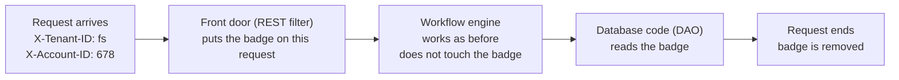

Step by step:

1. A request arrives with `X-Tenant-ID` and maybe `X-Account-ID`.
2. The **front door** (a small web filter) reads these two headers **once**.
   It saves them in the **request context** (the badge).
   - If the account is empty, `-1`, or the same as the tenant, we treat it as
     **no account**. (The auth proxy sends the tenant as the account when there
     is no account.)
3. The **workflow engine** does its normal work. It does not need to know
   about tenants.
4. The **database code** reads the badge when it needs it:
   - when it **creates** a workflow (to save the owner), and
   - when it **reads** a workflow or task (to check the owner).
5. When the request ends, the badge is **removed**. It can never leak into the
   next request.

**Background work** (timers, retries, the sweeper, system tasks) does not come
from a request, so it has **no badge**. That is fine: such work is trusted, and
the database code uses the owner that is **already saved** on the workflow.

---

## 4. What is stored

We added **4 new columns**. No new tables. No change to any primary key.

| Table | New columns | Why |
|---|---|---|
| `workflow_lookup` (workflow ID → where it is stored) | `tenant_id`, `account_id` | Every "get by ID" already reads this row to find the shard. Now the same read also gives the owner. |
| `workflows` (the workflow and all its tasks) | `tenant_id`, `account_id` as **static** columns | The owner is stored once per workflow. Task reads can check the owner without an extra lookup. |

When Conductor starts, it adds these columns to existing tables if they are
missing (`ALTER TABLE ... ADD`). New databases get them when the tables are
created.

---

## 5. How the storage slot (shard) is chosen

The shard is chosen **one time only**, when the workflow is created. After
that, it is **never calculated again**. Every later step reads the saved value.

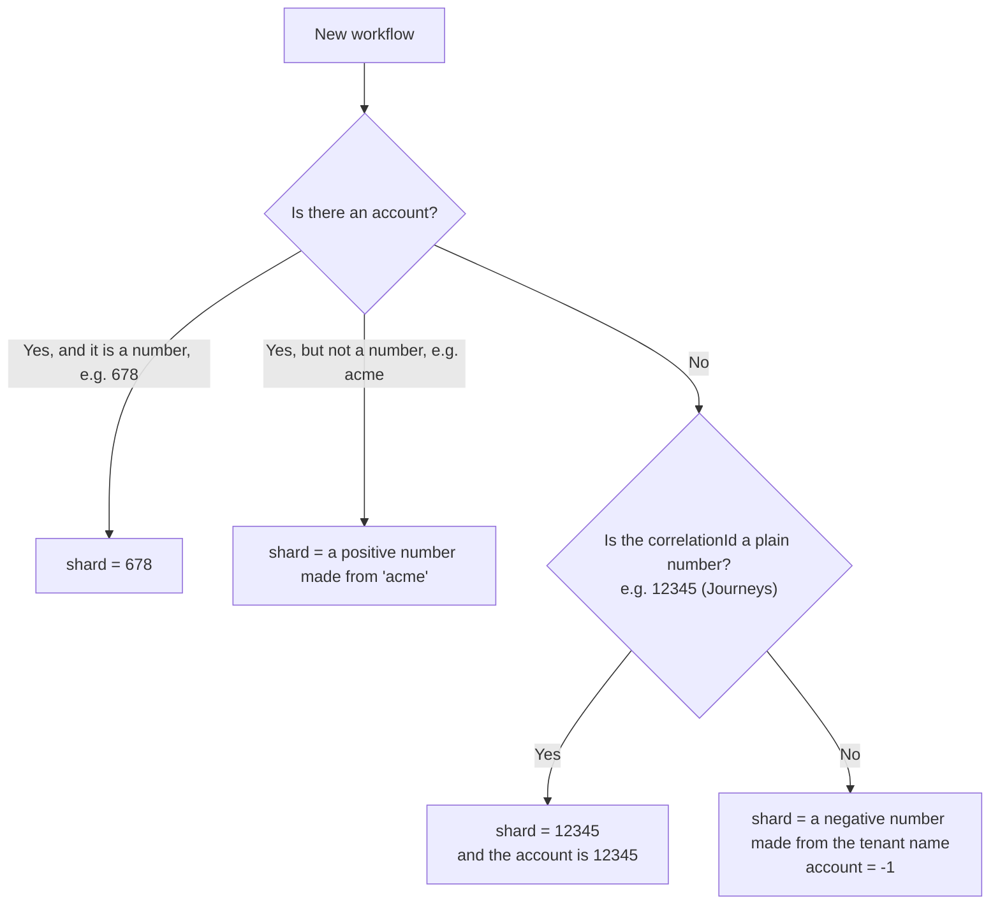

Rules to remember:

- **Positive shard** = the workflow has an account.
- **Negative shard** = the workflow belongs to the whole tenant (no account).
- **Shard 0** = old data only.
- Positive and negative never mix, so an account shard can never clash with a
  tenant shard.
- The number made from a name uses a standard hash (MurmurHash3). The same
  name always gives the same number, on every server and after every restart.
- Different workflows of the same tenant still sit in **different partitions**,
  because the workflow ID is part of the partition key. So one big tenant does
  not overload one place in the database.

---

## 6. The ownership check

When the database code reads a workflow or task for a caller, it asks one
question: **"Does the caller own this?"**

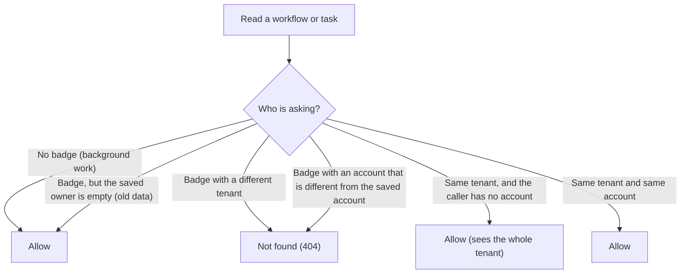

In short:

- **Different tenant** → not found.
- **Same tenant, different account** → not found.
- **Same tenant, caller has no account** → allowed. This is for admin or
  tenant-level users.
- **No badge** → allowed. This is for Conductor's own background work.

We answer **404 (not found)** instead of **403 (forbidden)**, so a caller
cannot learn that another customer's workflow ID exists.

---

## 7. Flows, step by step

### 7.1 Register a workflow definition

A workflow **definition** is the template (the list of steps). It is not a
running workflow.

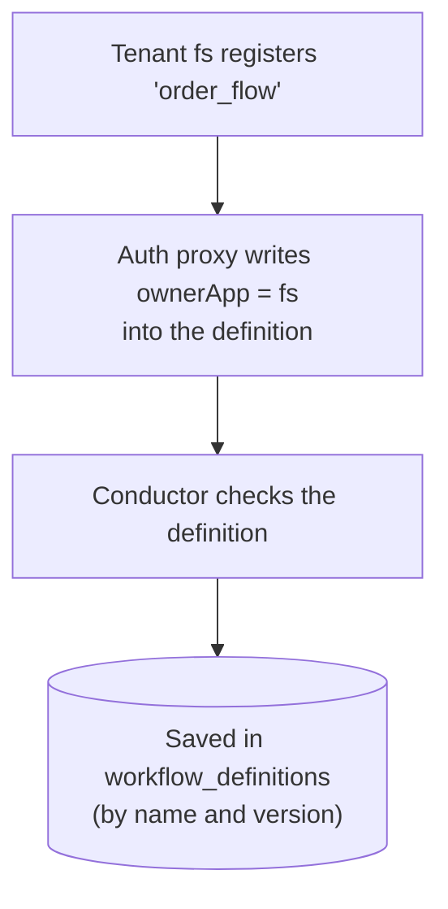

1. The tenant sends the definition.
2. The auth proxy writes the tenant into the definition's `ownerApp` field.
3. Conductor saves it.

Definitions are **shared by name**, the same as with Postgres today. We did not
add tenant columns to definition tables in this change.

---

### 7.2 Start a workflow

This is the most important flow. It is the **only** place where the owner and
the shard are decided.

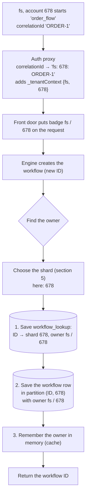

How the owner is found, in this order:

1. The **badge** from the request headers. (Normal case: every start goes
   through the auth proxy.)
2. If there is no badge and this is a **sub-workflow**: copy the **parent
   workflow's** owner.
3. If there is still no tenant: read `_tenantContext` from the workflow input.
4. If there is still no tenant: use `conductor.scylla.default-tenant`, if it is
   set.
5. If there is still no tenant: the workflow is saved **without an owner**, the
   old way. (See [section 11](#11-planned-strict-mode): we plan to reject this case.)

We save `workflow_lookup` **first**. So anyone who can find the workflow can
always find its shard.

---

### 7.3 Add tasks to a workflow

When the engine schedules the next step, it creates task rows.

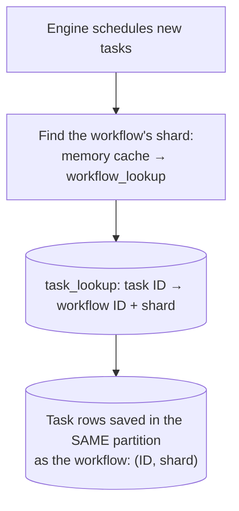

1. Find the workflow's shard (from memory, or from `workflow_lookup`).
2. Save each task in `task_lookup` (task ID → workflow ID + shard).
3. Save the task rows **in the same partition** as the workflow.

Tasks never choose their own shard. They always live with their workflow, so
they automatically have the same owner.

---

### 7.4 Update a workflow

The engine updates a workflow when it moves forward: a status change, new
output, completion, failure.

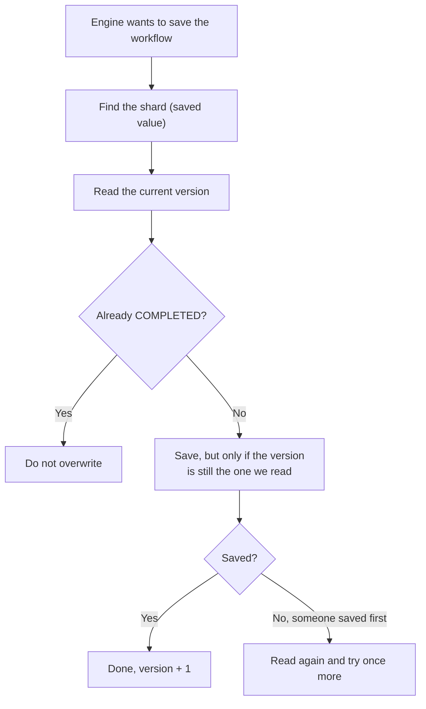

1. Find the shard from the saved value. Never from the correlationId.
2. Read the current version of the workflow.
3. Save the new state **only if nobody changed it in between** (version check).
4. If someone else saved first, read again and try once more.

**How this is scoped to the tenant:** actions from users (terminate, pause,
retry, complete a task) always **load the workflow first**, and that load is
checked (see 7.6). If the caller does not own the workflow, the action stops
there with 404 and this update never happens.

---

### 7.5 Update a task

A worker reports that a task is done (or failed).

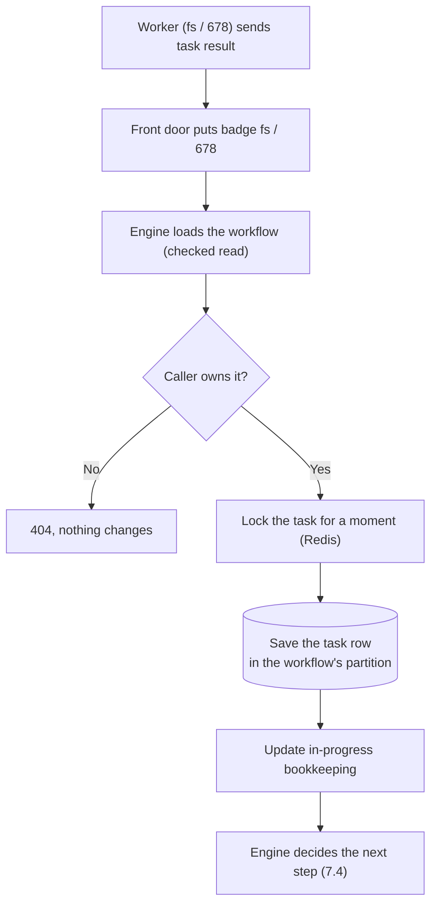

1. The engine loads the workflow. This load is **checked**.
2. If the caller is not the owner → **404**. The task is not touched.
3. If the caller is the owner → the task is locked briefly, saved in its
   workflow's partition, and the engine moves the workflow forward.

---

### 7.6 Get a workflow

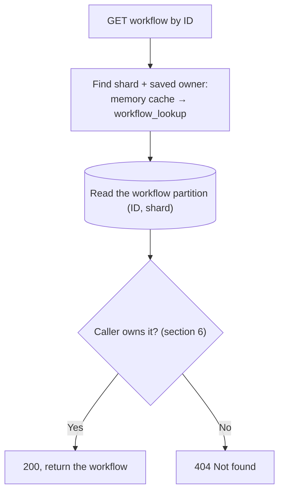

1. Find the shard and the saved owner (from memory, or from `workflow_lookup`).
2. Read the workflow.
3. Check the owner. Return it, or answer 404.

**With a shard hint** (a path used by Journeys that already knows the shard):

- Read the partition `(ID, hint)` directly and check the owner saved on it.
- If nothing is there (wrong hint, or someone else's ID), fall back to the
  normal lookup above, which also checks the owner.

---

### 7.7 Get a task

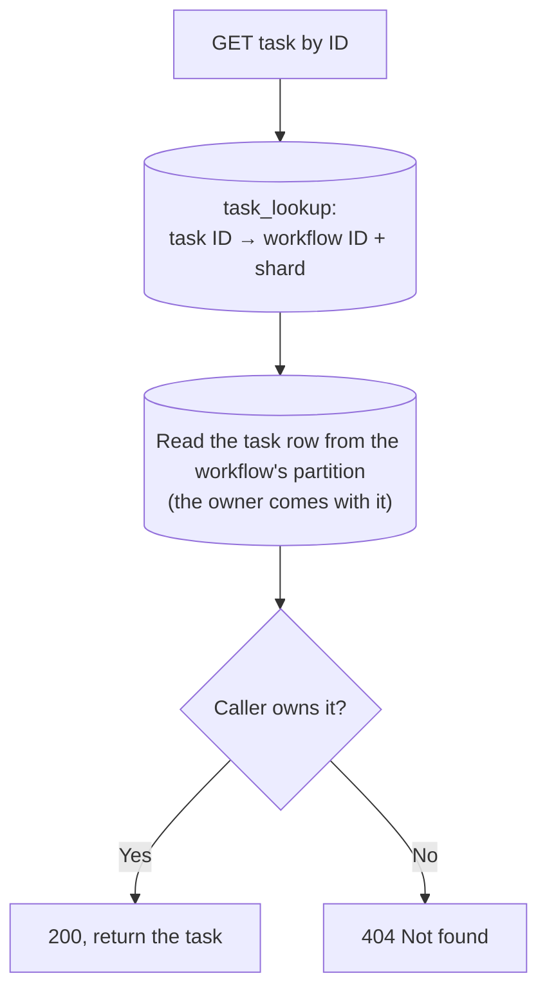

1. Find the task's workflow and shard in `task_lookup`.
2. Read the task row. The workflow's owner (static column) comes back with it,
   with no extra query.
3. Check the owner. Return the task, or answer 404.

---

### 7.8 Delete a workflow

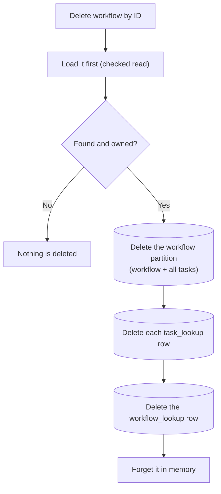

The `workflow_lookup` row is deleted **only** when the whole workflow is
deleted. Removing a single task (for example on a retry) keeps it. (Before
this change, removing one task deleted the workflow's lookup row by mistake.)

---

## 8. Example: two customers in one database

Three workflows are started:

| Workflow | Started by | correlationId sent | Saved owner | Shard |
|---|---|---|---|---|
| A | `journeys` | `12345` | journeys / 12345 | 12345 |
| B | `fs` + account `678` | `ORDER-1` (proxy makes it `fs: 678: ORDER-1`) | fs / 678 | 678 |
| C | `fs`, no account | `ORDER-2` (proxy makes it `fs: ORDER-2`) | fs / -1 | a negative number, e.g. -774889 |

What each caller can do:

| Caller | Action | Result | Why |
|---|---|---|---|
| fs / 678 | read B | ✅ 200 | same tenant, same account |
| fs / 999 | read B | ⛔ 404 | different account |
| journeys | read B | ⛔ 404 | different tenant |
| fs (no account) | read B or C | ✅ 200 | tenant-level caller sees the whole tenant |
| fs / 678 | read C | ⛔ 404 | C has no account (-1), the caller has 678 |
| fs | stop A | ⛔ 404 | A belongs to journeys; A keeps running |
| journeys | complete B's task | ⛔ 404 | not the owner; nothing changes |
| fs / 678 | complete B's task | ✅ 200 | owner; B moves on and completes |

All of these were tested against a local Scylla database.

---

## 9. Old data (created before this change)

Old data is **not reused in place**. The **migrator service** copies workflows
from Postgres and from the old Scylla into the new Scylla, and it sends the
tenant context with **every** request. So every migrated workflow gets an owner
when it is written, the same way as a new workflow (see
[7.2](#72-start-a-workflow)). There are no rows without an owner in the new
database.

What the migrator must do for each workflow:

- **Send the tenant:** `X-Tenant-ID` = the workflow's tenant.
- **Send the account too, when there is one:** `X-Account-ID` = the account
  from `_tenantContext.accountID` in the saved input (skip it when it is the
  same as the tenant).
  - Why this matters: the shard rule does **not** read the proxy-style
    correlationId (`fs: 678: ORDER-1`). If the account is not sent, the
    workflow is saved as `fs / -1` (whole tenant), and account users
    (`fs / 678`) would get 404 for their own workflows.
- **Journeys workflows:** a plain numeric correlationId (`12345`) with no
  account header gives shard `12345`, the same place as before.
- **Tasks** must be written into their workflow's partition, after the
  workflow, so they take its shard and owner.
- **If the migrator writes to Scylla directly** (not through Conductor), it must
  use exactly the same shard rule (section 5, MurmurHash3 x86_32, seed 0,
  UTF-8) and fill `tenant_id` / `account_id` in both `workflow_lookup` and the
  workflow partition. Going through Conductor avoids this.

Safety net (should not be needed after migration): if a row ever has no saved
owner, the check allows it, and if a workflow has no `workflow_lookup` row, the
old rule (numeric correlationId, else 0) is used to find it.

---

## 10. What this change does not do yet

- **Definitions are still shared by name.** Two tenants cannot have different
  definitions with the same name.
- **No "list all workflows of an account" from Scylla.** Search still uses
  OpenSearch (scoped by the auth proxy).
- **Some list and count features are still not supported** by Scylla
  persistence (pending/running lists, poll data).
- **gRPC calls are not covered.** Only the REST API sets the badge.
- **Requests without `X-Tenant-ID` are trusted.** This is safe only because all
  traffic goes through the auth proxy. Make sure only the auth proxy can reach
  the Conductor pods.

---

## 11. Planned: strict mode

All traffic goes through the auth proxy, so every new workflow should have a
tenant. Today, a workflow with no tenant at all is still saved, just without an
owner (step 5 in [7.2](#72-start-a-workflow)). We plan to make this stricter:

- Remove `conductor.scylla.default-tenant`.
- If no tenant can be found when a workflow is created, **reject** the start.
  Nothing is saved.
- The migrator always sends the tenant context
  ([section 9](#9-old-data-created-before-this-change)), so migrated data is
  not affected by strict mode.

Before turning this on, check two internal ways of starting a workflow. They
run in the background, so they have no badge:

- the **`START_WORKFLOW`** system task (one workflow starts another, unrelated one), and
- **event handlers** that start a workflow when a message arrives.

They will work in strict mode only if `_tenantContext` is in the new workflow's
input. Sub-workflows are not affected: they copy their parent's owner.
