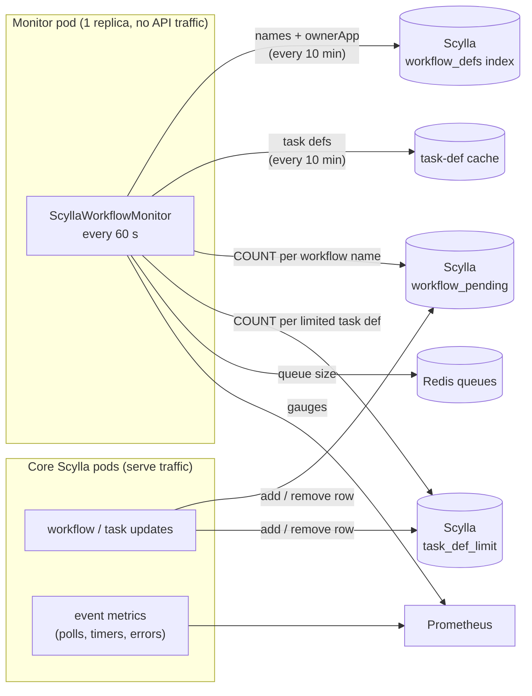

# Workflow monitor on Scylla: the fix and the results

This explains why Conductor's workflow metrics were costing hundreds of MB of heap per pod, what
we changed, how the Scylla implementation works, and what we measured before and after.

Branch: `scylla-queue-metrics` (commits `ca0e3a792`, `f4d3f7536`).

---

## 1. In one paragraph

Conductor publishes three "how many right now" metrics: running workflows, tasks waiting in a
queue, and tasks in progress. Core's `WorkflowMonitor` computes them every minute. To do that it
loaded **every version of every workflow definition** (about 162k on our Scylla) into memory every
10 minutes, and kept them all until the next refresh, on every pod. It only needed two fields
from each one: the workflow name and its owner. On Scylla, the counts also didn't work at all.
We replaced it on Scylla with `ScyllaWorkflowMonitor`. It publishes the **same metrics** but keeps
one tiny record per workflow name, runs on **one dedicated pod**, and gets its counts from small
Scylla tables. Retained heap dropped from **~200–1,100 MB per pod to ~50–100 MB**.

---

## 2. The metrics

| Metric | Labels | Meaning |
|---|---|---|
| `workflow_running` | `workflowName`, `ownerApp` | Workflows of a type that are not finished yet |
| `task_queue_depth` | `taskType`, `ownerApp` | Tasks waiting in the queue (the queue without a domain) |
| `task_in_progress` | `taskType`, `ownerApp` | Tasks currently being worked on. Published only for task definitions with a concurrency limit, and for async system tasks (`ownerApp="system"`). |

These are **gauges** (a current value). They read shared state (Scylla and Redis), so any one pod
can compute them for the whole cluster.

The other metrics, such as task polls, execution time, queue wait and errors, are **event
metrics**. They count what happens on each pod, so they stay on every core pod and are summed
across pods. This change does not touch them.

---

## 3. What was wrong

### 3.1 Core `WorkflowMonitor` loaded every definition

Every `metadata-refresh-interval` runs (default 10 runs × 60 s = every 10 minutes), core did:

```java
workflowDefs = metadataService.getWorkflowDefs();          // every version of every definition, in full
taskDefs = new ArrayList<>(metadataService.getTaskDefs());
```

and then used only `name` and the latest version's `ownerApp`. Problems:

- **Heap:** each parsed definition costs ~1.5–29 KB (measured, see section 7). Holding ~162k of
  them is hundreds of MB to several GB, held for the full 10 minutes until the next refresh.
- **Every pod:** the monitor is on by default (`conductor.workflow-monitor.enabled`), so every pod
  paid that cost and published identical numbers.
- **Scylla reads:** one read per definition version per refresh, per pod.

This is the same problem as upstream issue
[conductor-oss/conductor#1006](https://github.com/conductor-oss/conductor/issues/1006), with an
open fix in [#1145](https://github.com/conductor-oss/conductor/pull/1145).

### 3.2 On Scylla the counts didn't work

- `getPendingWorkflowCount` threw `UnsupportedOperationException`. `WorkflowMonitor` calls it
  first inside one `try/catch`, so **none** of the three metrics were published after the
  Postgres → Scylla migration.
- `getInProgressTaskCount` always returned `0`.

---

## 4. The fix at a glance



Four parts:

1. **Keep only what is needed.** One `(name, ownerApp)` record per workflow name, and one
   `(name, ownerApp, concurrencyLimit)` record per task definition, about 115 bytes each.
   Full definitions are never kept.
2. **Read definitions cheaply on Scylla.** Names come from the existing definition index. Only
   the latest version of each name is read, and only its `ownerApp` field is parsed.
3. **Counts from small tables.** Scylla keeps `workflow_pending` and `task_def_limit` up to date as
   workflows and tasks change, so each count is a single-partition `COUNT`.
4. **One pod does it.** A dedicated monitor deployment runs the gauges. The core pods turn core's
   monitor off and keep serving traffic and recording event metrics.

---

## 5. How the Scylla implementation works

### 5.1 `ScyllaWorkflowMonitor`

File: `src/main/java/com/netflix/conductor/scylla/metrics/ScyllaWorkflowMonitor.java`

Every `conductor.workflow-monitor.stats.delay` (default 60 s, first run after
`conductor.workflow-monitor.stats.initial-delay`, default 120 s):

1. **Refresh metadata when due** (every `conductor.workflow-monitor.metadata-refresh-interval`
   runs, default 10):
   - workflows: `WorkflowMetricInfoSource.getWorkflowMetricInfo()`, giving `(name, ownerApp)` per name;
   - tasks: `MetadataDAO.getAllTaskDefs()`, served from the task-def cache and reduced to
     `(name, ownerApp, concurrencyLimit)`.

   If the refresh fails, the previous lists are kept and the refresh is retried next run.
2. **Publish for each workflow name:** `COUNT` on `workflow_pending`, giving `workflow_running`.
3. **Publish for each task definition:** Redis queue size, giving `task_queue_depth`. Only if it
   has a concurrency limit, `COUNT` on `task_def_limit`, giving `task_in_progress`.
4. **Publish for each async system task:** queue size and in-progress count, with `ownerApp="system"`.
5. **Isolate failures:** each gauge has its own `try/catch`. One failing count skips only that
   gauge, and one warning per run says how many failed. Core used one `try/catch` for everything,
   so a single failure dropped all gauges for that run.

Metric names, labels and timing properties are the same as core's, so dashboards don't change.

### 5.2 Reading only `ownerApp` from definitions

Files: `dao/ScyllaMetadataDAO.java` (`getWorkflowMetricInfo`, `ownerAppOf`, `readDefinitions`) and
`dao/WorkflowDefIndex.java`.

- **Names** come from the definition index (`name/version` strings). No definition is read for them.
- **Only the latest version of each name** is read, in a window of 32 concurrent queries
  (`READ_CONCURRENCY`).
- **Each definition's JSON is scanned with a streaming parser** that stops at the top-level
  `ownerApp` field. It skips nested objects (tasks, mappings), so a nested `ownerApp` is ignored,
  and it never builds a `WorkflowDef`. Each JSON string is dropped as soon as it's parsed.
- **If the latest definitions are already cached** with the index (for example by the UI
  listing), they're projected from the cache with no reads.
- **Nothing is added to any cache**, so the full definitions don't linger.

`CacheableMetadataDAO`, the bean the server uses, passes `getWorkflowMetricInfo()` straight
through. Both DAOs implement `metrics/WorkflowMetricInfoSource.java`.

### 5.3 The count tables

Files: `dao/ScyllaBaseDAO.java` (schema), `dao/ScyllaExecutionDAO.java` (writes and counts).

| Table | Partition key | Clustering key | A row exists while… | Count used for |
|---|---|---|---|---|
| `workflow_pending` | `workflow_type` | `workflow_id` | the workflow is not terminal | `workflow_running` |
| `task_def_limit` | `task_def_name` | `task_id` (+ `workflow_id` column) | the task is IN_PROGRESS | `task_in_progress` |

- **`workflow_pending`** works like the Postgres DAO's table of the same name. A row is added on
  create and on every non-terminal update, and removed on a terminal update, terminate or remove.
  Re-adding it on each update repairs rows that were missed, for example workflows migrated from
  Postgres.
- **`task_def_limit`** was already used for concurrency limits. It's now kept for every
  IN_PROGRESS task, while `exceedsLimit` still only enforces limits when `concurrencyLimitEnabled`
  is set.
- **These writes never fail a workflow or task write.** A failure is logged and counted in
  `workflow_server_error_total{class="ScyllaExecutionDAO"}`.
- **Switched by `conductor.scylla.queue-metrics-enabled`** (default `true`). Keep it the same on
  every Scylla pod: each pod writes the rows for the work it handles.

### 5.4 Why it lives in `scylla-persistence`

`scylla-persistence` is a Freshworks-only module. Putting the monitor there means **no upstream
file is changed** (`core`, `postgres-persistence` and `mysql-persistence` match the branch base),
so syncing with OSS conductor causes no conflicts from this work. If upstream PR #1145 merges,
core's monitor gets the same definition-loading fix, and `ScyllaWorkflowMonitor` can be reviewed
for removal.

---

## 6. Deployment

| Property | Default | Monitor pod | Core Scylla pods |
|---|---|---|---|
| `conductor.workflow-monitor.enabled` (core, upstream) | `true` | **`false`** | **`false`** |
| `conductor.scylla.workflow-monitor.enabled` (ours) | `false` | **`true`** | leave out |
| `conductor.scylla.queue-metrics-enabled` | `true` | leave out | leave out |

```properties
# Monitor pod (conductor-monitor-scylla): replicas 1, no API Service/Ingress, still scraped
conductor.workflow-monitor.enabled=false
conductor.scylla.workflow-monitor.enabled=true

# Core Scylla pods (and any other Scylla deployment, e.g. conductor-async-scylla)
conductor.workflow-monitor.enabled=false
```

- `conductor.workflow-monitor.enabled=false` must be set on **every** pod. If it's left out, core's
  monitor runs there and loads every definition again. `ScyllaWorkflowMonitor` logs a warning if
  it finds core's monitor enabled on its own pod.
- If the monitor pod restarts, the gauges are missing for ~2 minutes (the initial delay).

---

## 7. Results

### 7.1 Cost per definition (measured locally, JDK 21)

Definitions were parsed the way core's monitor did it, then compared with the new record
(20,000 copies each, heap measured after GC).

| Definition | JSON size | Old: full `WorkflowDef` in heap | New: `(name, ownerApp)` record |
|---|---|---|---|
| Medium (e2e `sync_workflow_no_poller`) | 0.8 KB | ~1.5 KB | ~115 B |
| Small (3 tasks, synthetic) | 0.4 KB | ~3.3 KB | ~115 B |
| Large (e2e `re_run_test_workflow`) | 11 KB | ~28.7 KB | ~115 B |

Projected to ~162k definition versions:

| | Old monitor | New monitor |
|---|---|---|
| Held between refreshes | ~0.25–0.5 GB (small/medium defs); ~4.6 GB (large defs: doesn't fit) | one record per workflow **name**: a few MB (at most ~19 MB if every version were its own name) |
| Peak during a refresh | about double (old and new lists both held) | at most 32 definition JSON strings (~0.4 MB with large defs) |
| Where | every pod | one pod |

### 7.2 Sandbox (`conductor-sandbox`, Prometheus `prom-staging-ceapps`)

The drop happened at the deploy on **2026-11-25 ~12:00**. Today's image (`f4d3f7536`, with
`ScyllaWorkflowMonitor` on a dedicated pod) stays at the new level.

| | Before (core monitor on every pod) | After |
|---|---|---|
| Live data after GC (`jvm_gc_live_data_size_bytes`) | ~200–1,100 MB per pod, swinging constantly, peaks ~1,300 MB | **~50–100 MB**, flat |
| Old generation, lowest point over 30 min | ~200–900 MB, spikes up to ~1,450 MB | **~25–106 MB**, flat |
| Monitor pod (`conductor-monitor-scylla-*`) | n/a | **~70–75 MB**, the same as a normal pod |

**About an 80–90% reduction in retained heap.** The constant swings before the deploy are the old
monitor loading every definition and holding it until the next refresh. They disappear at the
deploy.

Caveat: this compares before and after a deploy, so other changes in that deploy, or a different
load, may also play a part. The pattern itself matches the old monitor exactly.

### 7.3 Series count (sandbox, before the single-pod switch)

| Metric | Series | Why |
|---|---|---|
| `task_queue_depth` | 4,591 | ~920 task definitions × 5 pods |
| `task_queue_depth_by_domain` | 2,486 | ~1,240 (task type × domain) × 2 Scylla pods |
| `task_in_progress` | 137 | task defs with a limit + system tasks |
| `workflow_running` | 82 | see the limitation in section 9 |

With only the monitor pod publishing, `task_queue_depth` drops to about one series per task
definition (~920). `task_queue_depth_by_domain` is unchanged for now (section 9).

---

## 8. How to check it yourself

```promql
# Only the monitor pod publishes the gauges (expect one row)
count by (pod) (task_queue_depth{namespace="conductor-sandbox"})

# Retained heap per pod, over days (MB)
max by (pod) (jvm_gc_live_data_size_bytes{namespace="conductor-sandbox"}) / 1024 / 1024

# Old generation after GC, the floor of the sawtooth (MB)
min_over_time(sum by (pod) (jvm_memory_used_bytes{namespace="conductor-sandbox", area="heap", id=~".*Old Gen.*"})[30m:]) / 1024 / 1024

# Bookkeeping write errors (should stay 0)
sum by (methodName) (rate(workflow_server_error_total{namespace="conductor-sandbox", class="ScyllaExecutionDAO"}[5m]))
```

```bash
# No full definitions held on the monitor pod (WorkflowDef ~0, WorkflowMetricInfo ~ number of names)
kubectl -n conductor-sandbox exec <monitor-pod> -- jcmd 1 GC.class_histogram \
  | grep -E "WorkflowDef$|WorkflowMetricInfo"
```

Logs on the monitor pod: `ScyllaWorkflowMonitor initialized.`, and no warning that
`conductor.workflow-monitor.enabled is true`.

---

## 9. Known limitations and next steps

- **`workflow_running` per workflow isn't usable in our Prometheus.** The platform drops the
  `workflowName` label, so the series of one owner collide and only one survives each scrape.
  Next step: a per-tenant total (`workflow_running_by_tenant`), plus a property to stop building
  per-workflow gauges.
- **`task_queue_depth_by_domain` still comes from every Scylla pod.** It shares
  `conductor.scylla.queue-metrics-enabled` with the bookkeeping writes. Next step: split the
  property so only the monitor pod publishes it.
- **Tombstones.** Every finished workflow or task leaves a delete marker in its
  `workflow_pending` / `task_def_limit` partition, so `COUNT` gets slower for busy types over time.
  Watch Scylla tombstone warnings.
- **Rows for workflows that predate tracking** (or migrated ones) appear only after their next
  update.
- **Event timers appear only after use.** `task_queue_wait` is created on a pod the first time
  that pod hands out a new task, so it shows "No data" after a restart until new work arrives.

---

## 10. Files

| File | What it is |
|---|---|
| `src/main/java/com/netflix/conductor/scylla/metrics/ScyllaWorkflowMonitor.java` | The monitor |
| `src/main/java/com/netflix/conductor/scylla/metrics/WorkflowMetricInfo.java` | `(name, ownerApp)` record |
| `src/main/java/com/netflix/conductor/scylla/metrics/WorkflowMetricInfoSource.java` | Interface implemented by the metadata DAOs |
| `src/main/java/com/netflix/conductor/scylla/dao/ScyllaMetadataDAO.java` | `getWorkflowMetricInfo`, `ownerAppOf`, windowed reads |
| `src/main/java/com/netflix/conductor/scylla/config/cache/CacheableMetadataDAO.java` | Passes `getWorkflowMetricInfo` through |
| `src/main/java/com/netflix/conductor/scylla/dao/ScyllaExecutionDAO.java` | `workflow_pending` / `task_def_limit` writes and counts |
| `src/main/java/com/netflix/conductor/scylla/dao/ScyllaBaseDAO.java` | Table schemas |
| `src/main/java/com/netflix/conductor/scylla/config/ScyllaConfiguration.java` | Bean, conditional on `conductor.scylla.workflow-monitor.enabled` |
| `src/test/groovy/com/netflix/conductor/scylla/metrics/ScyllaWorkflowMonitorSpec.groovy` | Monitor tests (8 cases) |
| `src/test/groovy/com/netflix/conductor/scylla/dao/WorkflowMetricInfoSpec.groovy` | `ownerAppOf` tests |
| `src/test/groovy/com/netflix/conductor/scylla/dao/ScyllaExecutionStatsSpec.groovy` | Counts and metric info against a real Scylla node |
